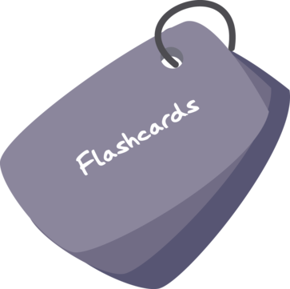

# Project 1: Triple Peaks Library

The Triple Library webpage is the first project in the Software Engineering program at TripleTen. It was created at using HTML and CSS, base on a design brief.

## Project features

- Semantic HTML5
- Flexbox
- Positioning
- Vertical stacking with z-index

Italics: _asterisks_ or _underscores_.

Bold: **asterisks** or double **underscores**.

Combined italics and bold: **asterisks and** _underscores_\*\*.

Cross out text: ~~Don't need this.~~
Ordered list

1. The first point of a numbered list.
2. The second point.

Unordered list

- The first point of an unordered list
- The second point of an unordered list
  The text of the link goes in square brackets, the URL goes in parentheses.

For example, here is a link to [MDN](https://developer.mozilla.org/en-US/).

Inline code is wrapped in backticks, like
this `console.log("Hello, world!");`

Code blocks are wrapped (or "fenced") in three backticks.
By default, there's no syntax highlighting.

```
touch README.md
```



# Flashcard App

My first project in TripleTen's AI-Assisted Software
Engineering program. It includes decks of flashcards,
each of which can be viewed in a carousel.

## Features

## Technologies used
